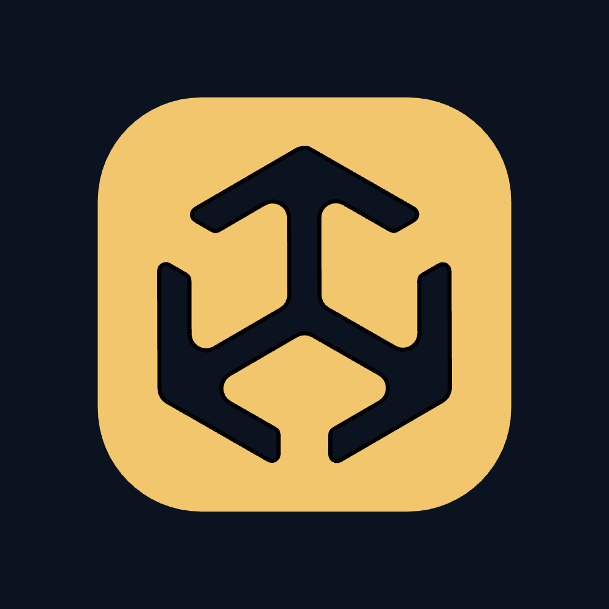

# setpos.gg on GitHub

The [organisation profile](profile/README.md) and its brand assets.



Rebuild the pictures with Node 24+, the setpos checkout's dependencies and Google Chrome installed:

```sh
node brand/build.mjs /path/to/setpos
```

The source checkout defaults to the setpos root when this repo is at `setpos/oss/.github`.
The build uses Playwright to render embedded HTML/SVG and Sharp to compress PNGs. It makes no
network requests. Fonts come from the source checkout's Fontsource dependencies.

Sources: `assets/brand/setpos-logo.svg`, `static/favicon.svg`, `static/radars/mirage/radar.svg`,
`src/lib/maps.ts`, `src/lib/competitive-spawns.json` and `src/lib/crosshair.ts`. The builder reads
them directly; it keeps no second copy of the map, spawn data or crosshair implementation.
The crosshair examples show the site's crosshair plus three configurations drawn by its renderer,
at rest with a grenade, enlarged on a whole-pixel grid.

The avatar has a 160px inset so the square mark fits inside a circular crop. Social cards are
1280 × 640; primary content stays within x=96–1176 and y=88–542. Upload the matching
`brand/social-<repo>.png` in each repository's social preview settings.

## Organisation settings

- Display name: **setpos.gg**
- Description: **Free CS2 instant smoke lineups from every spawn, made from pro demos. Minimap, spawn and crosshair tools for developers.**
- Website: **https://setpos.gg**
- Avatar: `brand/avatar.png`

## Repository settings

| Repository | Description | Topics |
| --- | --- | --- |
| cs2-minimaps | Vector CS2 minimaps in dark and light, with SVGs, PNGs and radar calibration. From setpos.gg. | `cs2`, `counter-strike-2`, `minimap`, `svg`, `radar`, `game-maps`, `setpos` |
| cs2-spawns | Every competitive CS2 spawn, with coordinates and ready-to-paste setpos and setang commands. From setpos.gg. | `cs2`, `counter-strike-2`, `spawn-points`, `coordinates`, `game-data`, `setpos` |
| cs2-crosshair | TypeScript tools for CS2 crosshair share codes, exact drawing and the grenade reticle. From setpos.gg. | `cs2`, `counter-strike-2`, `crosshair`, `typescript`, `share-codes`, `rendering`, `setpos` |

Counter-Strike 2 is a trademark of Valve Corporation. Not affiliated with Valve.
